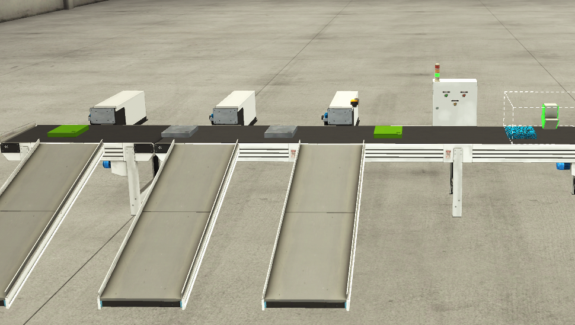
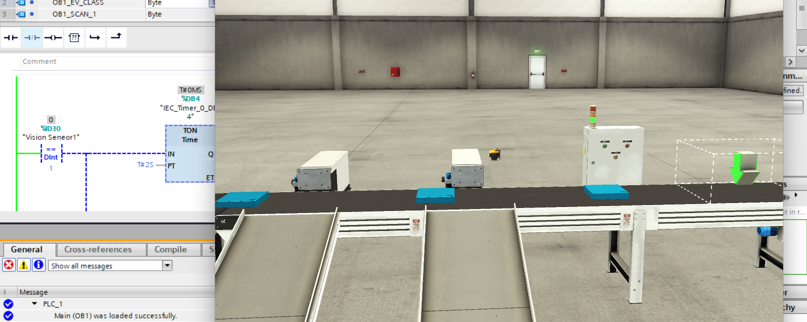
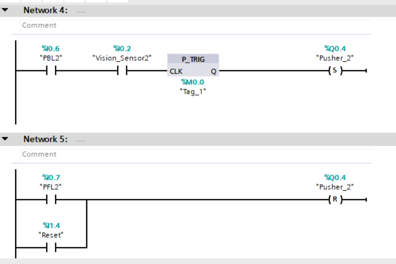

# Automated Color Sorting Conveyor Line — Siemens PLC & Factory I/O

-009999)

-lightgrey)

> **An automated 3-way industrial color sorting system programmed in Siemens TIA Portal V17 (Ladder Logic) and co-simulated in real time with a 3D Factory I/O conveyor line using a Vision Sensor, pneumatic pushers, limit switches, and stack-light indicators.**

---

## 📦 Project Files
👉 **[Download Siemens TIA Portal V17 Project (`TIA_Portal_Color_Sorting_V17.zip`)](plc_project/TIA_Portal_Color_Sorting_V17.zip)**

---

## 🎯 Project Overview
This project implements an industrial-grade automated sorting line integrating **Siemens TIA Portal V17** (`PLC_1 [CPU 313C-2 DP]`) with **Factory I/O**. Items spawned by an automated emitter travel along a dual-belt conveyor (`2 m` + `6 m`), pass under a **Vision Sensor** that outputs an integer color/part ID (`DInt`), and are diverted into three dedicated sorting chutes via pneumatic pushers controlled by timed and limit-switch-verified Ladder Logic (`OB1`).

- **Author & Sole Developer:** Afnan Aref *(PLC Programming, I/O Tag Configuration & 3D Factory I/O Co-Simulation)*

---

## 🔌 PLC I/O Mapping (`Siemens S7-300` ↔ `Factory I/O`)

| Input Address | Tag / Device | Output Address | Tag / Device |
| :---: | :--- | :---: | :--- |
| `%I0.0` | Factory I/O (Running) | `%Q0.0` | Belt Conveyor (2m) 1 |
| `%I0.4` / `%I0.5` | Pusher 1 (Back / Front Limit) | `%Q0.1` | Belt Conveyor (6m) 1 |
| `%I0.6` / `%I0.7` | Pusher 2 (Back / Front Limit) | `%Q0.2` | Emitter 1 (Emit) |
| `%I1.0` / `%I1.1` | Pusher 3 (Back / Front Limit) | `%Q0.3` | Pusher 1 |
| `%I1.2` | Start Button 1 | `%Q0.4` | Pusher 2 |
| `%I1.3` | Stop Button 1 | `%Q0.5` | Pusher 3 |
| `%I1.4` | Reset Button 1 | `%Q0.6` | Stack Light 1 (Red) |
| `%ID30` (`DINT`) | Vision Sensor 1 (Color ID) | `%Q0.7` | Stack Light 1 (Green) |
| — | — | `%Q1.0` | Stack Light 1 (Yellow) |

---

## ⚙️ Ladder Logic Control Architecture (`OB1`)
1. **Start/Stop Latching & Conveyor Control:** Uses `FactoryIO_Running (%I0.0)`, `Start (%I1.2)`, and `Stop (%I1.3)` interlocks to latch `Conveyor_1 (%Q0.0)`, `Conveyor_2 (%Q0.1)`, `Emitter (%Q0.2)`, and the status stack light.
2. **Vision-Based Color Classification:** Compares `%ID30` (`DInt`) against target item IDs and triggers `IEC_Timer` (`TON`, `PT = T#2S`) delays to synchronize item travel time from the vision sensor to each pusher station.
3. **Edge-Triggered Pusher Actuation & Safe Retraction:** Combines back-limit verification (`PBL`) with positive-edge detection (`P_TRIG`) to set each pusher (`S`), and automatically resets (`R`) upon reaching the front limit switch (`PFL`) or pressing `Reset (%I1.4)`.

| Live Co-Simulation (TIA Portal + Factory I/O) | Ladder Logic Pusher Control (Networks 4–5) |
| :---: | :---: |
|  |  |

---

## 🚀 How to Run
1. Extract `plc_project/TIA_Portal_Color_Sorting_V17.zip` and open `colors with factory io.ap17` in **Siemens TIA Portal V17**.
2. Start **PLCSIM**, compile, and download `Main (OB1)` to `PLC_1 [CPU 313C-2 DP]`, then switch the CPU to **RUN**.
3. Open the sorting scene in **Factory I/O**, connect the Siemens S7-PLCSIM driver using the I/O map above, and press **Start** on the control panel.
